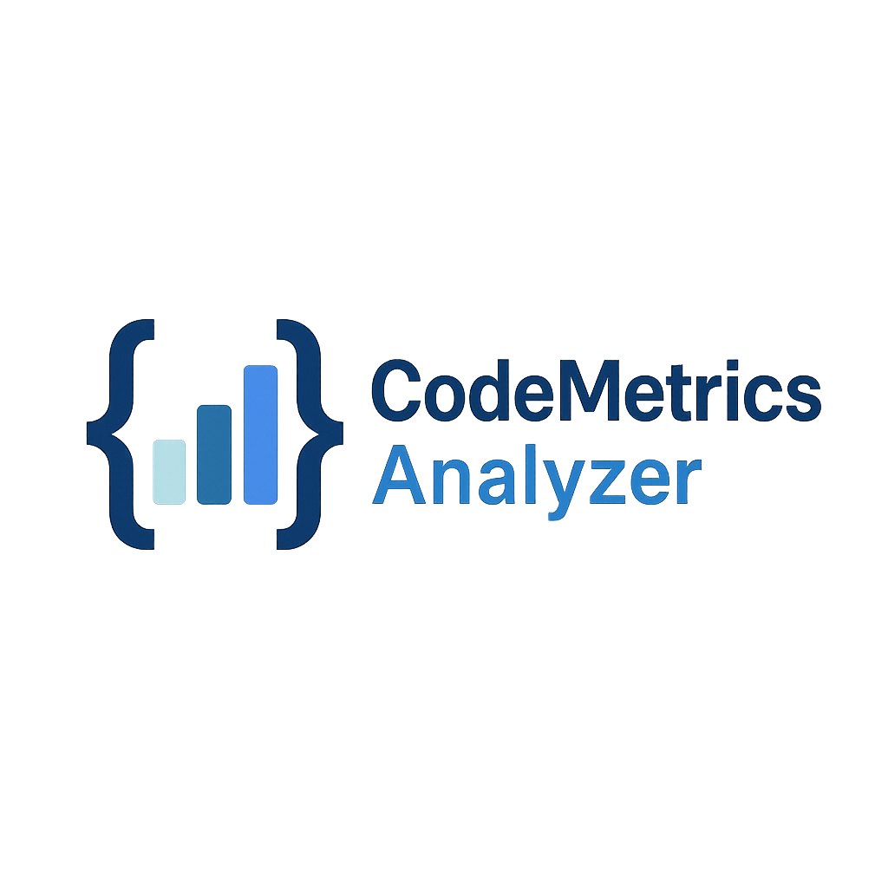

# ADS-2025-2026-Grupo-Diurno-A
## Elementos do Grupo:
    Ema Reis nº110847 | username: emasreis
    Mariana Capela nº104715 | username: mariana-iwtd
    Nádia Gavancha nº110805 | username: nadiaprg

##  Notas importantes
Na pasta **_Screenshots_Trello_**, estão todas as capturas de ecrã do Trello que documentam o processo de desenvolvimento do projeto.

O ficheiro **_Relatorio_Projeto.pdf_** contém o relatório final do projeto.

Na pasta **_JavaDoc_** estão todos os documentos JavaDoc.

  

## Ferramenta de Análise de Métricas de Código (Java)

Esta ferramenta é uma aplicação Java desenvolvida para realizar a **análise estática de código**. A aplicação calcula diversas métricas de qualidade de software, permitindo avaliar a complexidade, estrutura e manutenibilidade do código.

Na interface gráfica é feita a seleção de projetos e visualização de resultados, e também exportação para CSV.

A ferramenta calcula as seguintes métricas por classe:
* **LOC:** Lines of Code (Linhas de Código Físicas)
* **NOM:** Number of Methods (Número de Métodos)
* **NOA:** Number of Attributes (Número de Atributos)
* **MCC:** McCabe’s Cyclomatic Complexity (Complexidade Ciclomática)
* **CBO:** Coupling Between Objects (Acoplamento entre Objetos)
* **DIT:** Depth of Inheritance Tree (Profundidade da Árvore de Herança)
* **NOC:** Number of Children (Número de Filhos)
* **NPRM:** Number of Parameters per Method (Média de Parâmetros)
* **AvgLOC:** Average LOC per Method (Média de Linhas por Método)

##  Como Executar

### Pré-requisitos
* Java 9 ou superior instalado.
* Maven instalado e configurado nas variáveis de ambiente.

### Instruções
1. Abra o terminal na raiz do projeto (onde está o ficheiro `pom.xml`).
2. Execute o seguinte comando para compilar e iniciar a aplicação:

>mvn clean javafx:run